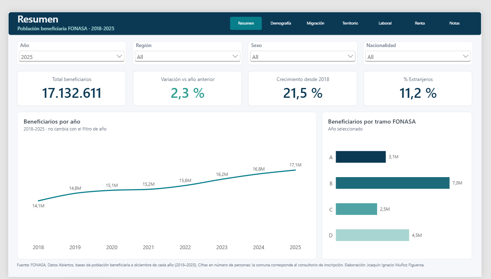
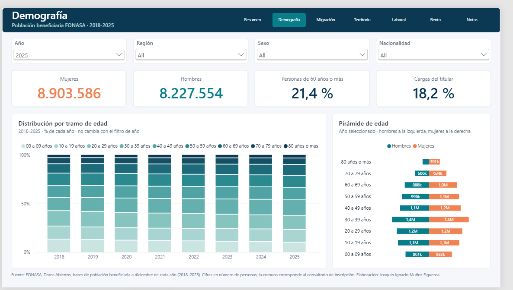
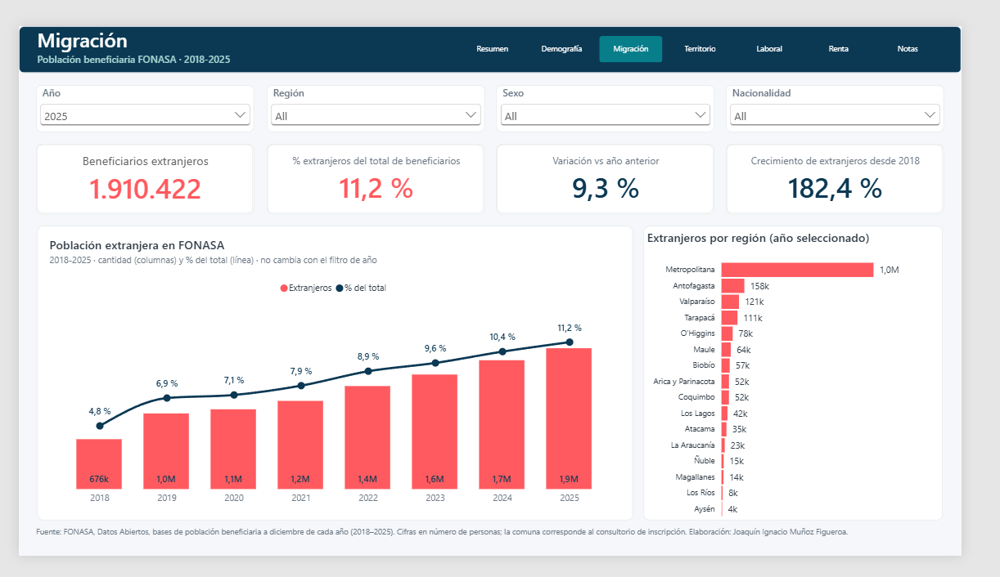
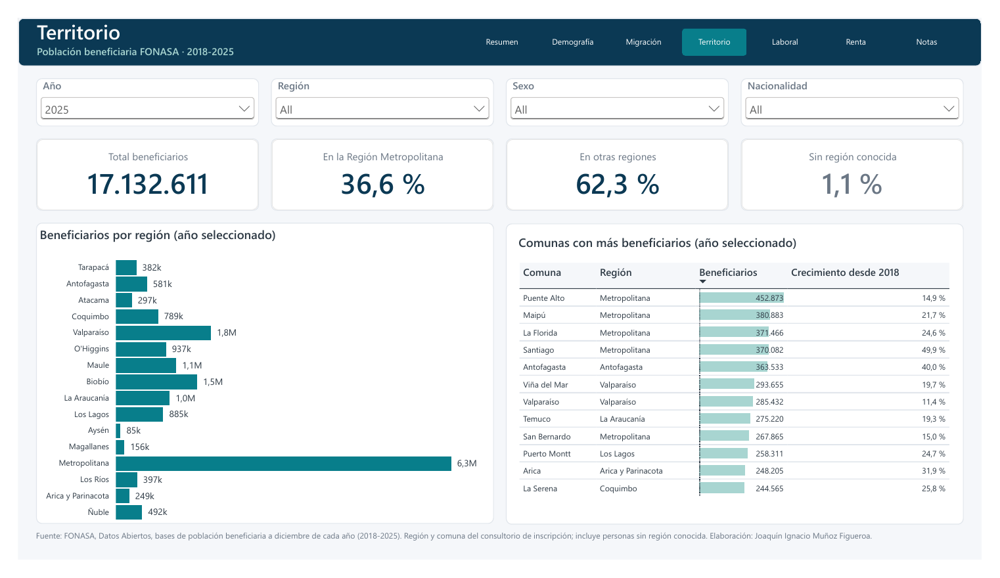
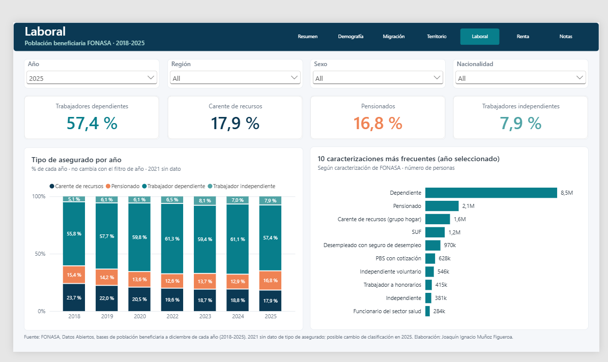
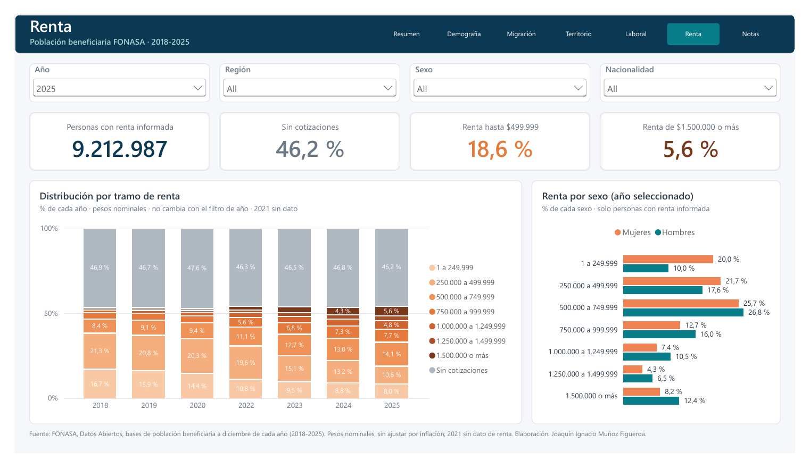
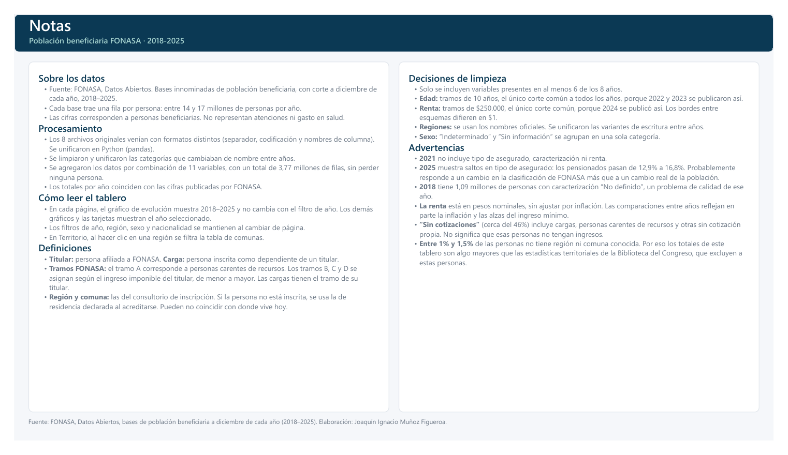

# Población beneficiaria FONASA 2018-2025

Análisis de los más de 17 millones de personas beneficiarias del Fondo Nacional de Salud (FONASA) de Chile, a partir de los microdatos abiertos que publica la institución: limpieza y unificación de 8 años de datos en Python, y un tablero interactivo en Power BI.



## Resumen

- **Datos:** 8 archivos anuales (2018-2025), una fila por persona, con corte a diciembre. Suman unos 19 GB y casi 125 millones de filas.
- **Problema:** cada periodo viene con formatos distintos: separador (`|` o `,`), codificación (latin-1 o utf-8), nombres de columna, cortes de edad y de renta, y escritura de las categorías.
- **Solución:** un flujo en Python (pandas + Parquet) que procesa año por año, unifica todo a un esquema común y agrega los datos en una tabla de 3,77 millones de filas para Power BI, sin perder ninguna persona.
- **Resultado:** un tablero de 7 páginas: Resumen, Demografía, Migración, Territorio, Laboral, Renta y Notas metodológicas.

## Principales hallazgos

- **Crecimiento:** FONASA pasó de 14,1 millones de beneficiarios en 2018 a 17,1 millones en 2025, un aumento de 21,5%.
- **Migración:** la población extranjera casi se triplicó: de 676 mil (4,8% del total) a 1,91 millones (11,2%). El mayor salto fue entre 2018 y 2019, con un 52% más en un solo año.
- **Territorio:** después de la Región Metropolitana, las regiones con más beneficiarios extranjeros son Antofagasta y Tarapacá, por delante de regiones con mucha más población total como Valparaíso y Biobío.
- **Envejecimiento:** las personas de 60 años o más pasaron de 19,2% a 21,4% del total, y el tramo de 0 a 9 años bajó de 13,0% a 9,9%.
- **Tipo de asegurado:** los carentes de recursos bajaron de 23,7% a 17,9% entre 2018 y 2025.
- **Renta por sexo (2025):** entre las personas con renta informada, el 20,0% de las mujeres está en el tramo más bajo (hasta $249.999), contra el 10,0% de los hombres. En el tramo de $1.500.000 o más se invierte: 8,2% de las mujeres y 12,4% de los hombres.

## Validación

Los totales por año coinciden con las cifras publicadas:

| Año | Beneficiarios | Referencia |
|---|---|---|
| 2018 | 14.102.709 | - |
| 2019 | 14.841.577 | - |
| 2020 | 15.142.528 | - |
| 2021 | 15.233.814 | Crecimiento de 0,6% respecto a 2020, igual al informado por FONASA |
| 2022 | 15.613.584 | Igual a la cifra de FONASA publicada en la prensa |
| 2023 | 16.229.898 | 10 personas de diferencia con el informe de FONASA |
| 2024 | 16.752.189 | Igual al informe de FONASA sobre migración desde isapres |
| 2025 | 17.132.611 | Igual al archivo de resultados agregados de FONASA |

Las estadísticas territoriales de la Biblioteca del Congreso Nacional muestran totales algo menores. La diferencia corresponde exactamente a las personas sin región o comuna conocida, que esa fuente no cuenta.

## Flujo de trabajo

| Notebook | Qué hace | Entrada → Salida |
|---|---|---|
| [`01_inventario_renombre.ipynb`](01_inventario_renombre.ipynb) | Inventario de archivos, detección de codificación y separador, comparación de columnas entre años y renombre a un esquema común | CSV originales → Parquet renombrados |
| [`02_perfil_valores.ipynb`](02_perfil_valores.ipynb) | Perfil de valores por columna y año, validación de totales, reglas de limpieza y revisión de vacíos | Parquet renombrados → Parquet limpios |
| [`03_tabla_power_bi.ipynb`](03_tabla_power_bi.ipynb) | Agregación de los 8 años por combinación de 11 variables, validación de totales y columnas de orden | Parquet limpios → tabla para Power BI |

Cada año se procesa por separado para no cargar los 19 GB en memoria a la vez.

## Decisiones de limpieza

- Se conservan solo las variables presentes en al menos 6 de los 8 años (11 dimensiones más el conteo).
- **Edad:** tramos de 10 años, el único corte común a todos los años (2022 y 2023 se publicaron solo así).
- **Renta:** tramos de $250.000, el único corte común (2024 se publicó solo así). Los bordes entre esquemas difieren en $1.
- **Regiones:** nombres oficiales; se unificaron las variantes de escritura entre años (por ejemplo, las dos versiones de O'Higgins en 2018 y las de Ñuble).
- **Comunas:** se unificaron variantes como "Cabo de Hornos (Ex - Navarino)" y "Ranquil"/"Ránquil".
- **Sexo:** "Indeterminado" y "Sin información" se agrupan en una sola categoría.
- **Tipo de asegurado y caracterización:** se unificaron las categorías que cambiaron de nombre en 2025.
- Las personas sin región ni comuna se registran como "Desconocida", para que los totales nacionales sigan calzando con FONASA.

## Advertencias

- **2021** no incluye tipo de asegurado, caracterización ni renta.
- **2025** muestra saltos en tipo de asegurado (los pensionados pasan de 12,9% a 16,8%), probablemente por un cambio en la clasificación de FONASA más que por un cambio real de la población.
- **2018** tiene 1,09 millones de personas con caracterización "No definido".
- **La renta** está en pesos nominales, sin ajustar por inflación.
- **"Sin cotizaciones"** (cerca del 46%) incluye cargas, personas carentes de recursos y otras sin cotización propia; no significa que no tengan ingresos.
- **Región y comuna** corresponden al consultorio de inscripción, que puede no coincidir con el lugar donde la persona vive.

## Tablero

El archivo [`power-bi/Fondo_Nacional_de_Salud_2018-2025.pbix`](power-bi/) se abre con Power BI Desktop. En cada página, el gráfico de evolución muestra 2018-2025 y los demás visuales muestran el año seleccionado.

| Demografía | Migración |
|---|---|
|  |  |

| Territorio | Laboral |
|---|---|
|  |  |

| Renta | Notas metodológicas |
|---|---|
|  |  |

## Cómo reproducirlo

1. Descarga las bases de beneficiarios 2018-2025 desde el portal de [Datos Abiertos de FONASA](https://datosabiertos.fonasa.cl/dimensiones-beneficiarios/) y deja los CSV en una carpeta `base-beneficiarios-data/`, con nombres `beneficiarios_fonasa_<año>.csv`.
2. Crea un entorno virtual e instala las dependencias:
   ```bash
   python -m venv .venv
   pip install -r requirements.txt
   ```
3. Ajusta la ruta de la carpeta del proyecto al inicio de cada notebook (están escritas como rutas absolutas de Windows).
4. Ejecuta los notebooks en orden: 01, 02 y 03.
5. Abre el `.pbix` y, si cambiaste la ubicación, actualiza la ruta del origen de datos a `power-bi/fonasa_beneficiarios_agregado.parquet`.

Los datos originales no se incluyen en el repositorio por su tamaño. La tabla agregada final (11 MB) sí está incluida, para poder abrir y actualizar el tablero sin rehacer todo el procesamiento.

## Herramientas

Python 3.14 · pandas · pyarrow · Jupyter · Power BI Desktop · DAX

## Fuente

FONASA, Datos Abiertos, bases de población beneficiaria a diciembre de cada año (2018-2025). Uso sujeto a los términos y condiciones del portal de datos abiertos de FONASA.

## Autor

Joaquín Ignacio Muñoz Figueroa · Ingeniero Civil Industrial, Universidad de Concepción · LinkedIn: [linkedin.com/in/joaquin-munoz-figueroa-cl](https://www.linkedin.com/in/joaquin-munoz-figueroa-cl)
